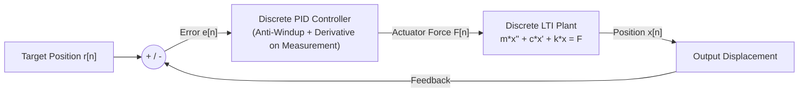

# Discrete-Time Mass-Spring-Damper Simulation & Embedded C PID Control (`yay-kutle-sonum-sistemi`)

Numerical discretization and closed-loop control of a **Linear Time-Invariant (LTI) second-order mechanical Mass-Spring-Damper system** using **Finite Difference Approximation (Sonlu Farklar Yöntemi)** in Python and a **deterministic Embedded C PID controller** (`embedded_c/discrete_pid.c`) suitable for real-time microcontroller execution (`TIM` periodic ISR on STM32/Cortex-M4F).

---

## Mathematical Formulation

The continuous-time equation of motion for a 1-DOF mass-spring-damper system subjected to an external control/disturbance force $F(t)$ is:

$$m \frac{d^2x(t)}{dt^2} + c \frac{dx(t)}{dt} + k x(t) = F(t)$$

Using backward finite differences with fixed sampling period $T_s$ ($\Delta t$):

$$\dot{x}[n] \approx \frac{x[n] - x[n-1]}{T_s}, \qquad \ddot{x}[n] \approx \frac{x[n] - 2x[n-1] + x[n-2]}{T_s^2}$$

Substituting into the governing ODE yields the **causal recurrence equation** executed at each discrete sample instant $n$:

$$x[n] = \frac{T_s^2 F[n] + (2m + c T_s) x[n-1] - m x[n-2]}{m + c T_s + k T_s^2}$$

---

## Closed-Loop Embedded Control Topology

---

## Embedded C Implementation (`embedded_c/discrete_pid.c`)

To bridge theoretical simulation with real-world firmware, this repository includes a production-ready C99 discrete PID controller featuring:
- **Clamping Integrator Anti-Windup:** Prevents actuator saturation overshoot.
- **Derivative-on-Measurement ($-\frac{K_d}{T_s}(x[n] - x[n-1])$):** Eliminates destructive "derivative kick" when the setpoint $r[n]$ changes abruptly.
- **Discrete Plant Difference Equation Solver:** Runs in $O(1)$ time with zero dynamic memory allocation inside a hardware timer interrupt (`1 kHz` control loop).
